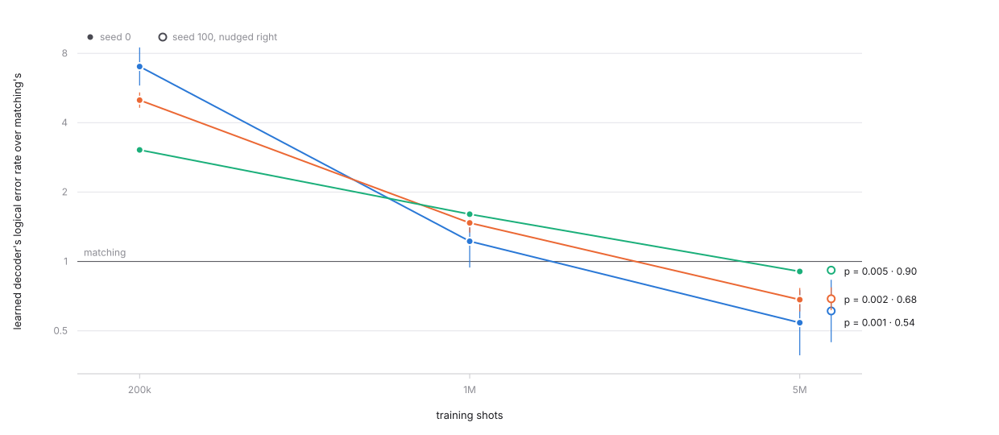
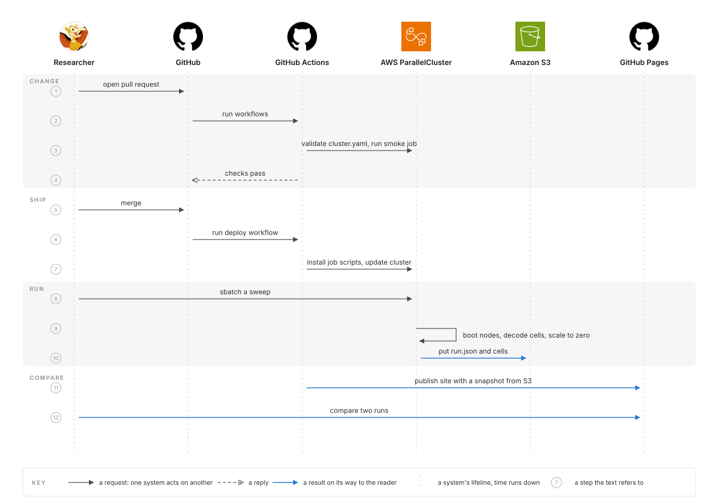

# QEC sweep on AWS HPC

A learned decoder for the surface code, trained and judged on a Slurm cluster on AWS that exists only while work runs. Every number here walks back to the run that produced it, and every experiment was registered before it ran.

<picture>
  <source media="(prefers-color-scheme: dark)" srcset="docs/figures/learning-curve-dark.svg">
  
</picture>

Trained on 5,000,000 syndrome histories, a two-layer LSTM from the published recipe makes 10% fewer logical errors than minimum-weight matching on the distance-5 surface code under correlated noise, and 46% fewer at the lowest rate, one it never trained on. A second seed agrees. Under depolarising noise, where matching is near optimal, the same training is 16% worse than matching. The five runs behind the figure cost $2.63.

Two stages wait on quota: the GPU path, and the EFA points of the MPI stage. Everything they plug into is built.

## What was hard

- **No number is typed in.** The State of an experiment is a tool's output pasted with its command; a hook refuses a closed record whose Prediction differs from the one committed before the run. Two predictions are recorded as wrong because of it.
- **The account said no.** No GPU or HPC quota, no spot, no identity federation for GitHub. The design routes around each: CodeBuild runners carrying roles instead of OIDC, TCP scaling reported as provisional, a GPU queue the interfaces are ready for.
- **Elastic compute makes cost a per-run number**, and the defaults fight it. Slurm hands tasks to nodes still booting; the three-minute scale-down that made a sweep cheap made a chained run slow; a baked AMI saves the installs but not the boot.

## Numbers

Each stage ends with one measurement. The full account of each, with its comparison and what it taught, is in [the plan](docs/plan.md).

| Stage | Measured | Result |
| --- | --- | --- |
| 3, frozen environment | fresh node to a reproduced result, from the image alone | 3.7 min |
| 4, cluster | `sbatch` to the first node, from a powered-down queue | 4.0 min; 3.2 with the baked AMI |
| 5, job array | the 200-cell grid on four cold nodes, against a ten-core laptop | 7.3 min against 1.4; 5.1 of it was booting |
| 6, scale and cost | cells per node-hour at 1 and 16 nodes | 1478 and 887; 1507 at 16 once the grid ran longest cells first |
| 7, tight coupling | strong-scaling efficiency at 2 and 16 nodes over TCP, 25 qubits | 61% and 21%; the exchanges take three quarters of the time at 16 |
| 8, cluster as code | changes shipped to a running cluster without SSH | every change since |
| 12, decoder loop | samples to comparison plot, unattended, on a cold cluster | 4.3 min for $0.24 |
| 13, provenance | figures that resolve through S3 keys alone to a complete record | 16 of 21 |
| 14, comparison site | Lighthouse performance on a throttled phone; the query in the browser | 100; 11 ms median |
| 15, shorter loop | the platform's share of commit to first cell; dollars per 16-node sweep | 5.6 min from 6.4; $0.098 from $0.30 |
| 16, research loop | learned over matching at distance 5, correlated noise, by training shots | 3.05, 1.60, 0.90 at 200k, 1M, 5M; 0.92 on a second seed; 1.16 under depolarising noise |

## The platform

<picture>
  <source media="(prefers-color-scheme: dark)" srcset="docs/figures/loop-dark.svg">
  
</picture>

A change travels through a pull request. CI validates the cluster configuration against the account, runs a smoke job on the head node, plans Terraform and judges a changed decoder manifest against the one in force; the merge installs the job scripts, applies the configuration and applies Terraform. A run writes its record and its cells under its own key in a bucket whose versions cannot be deleted for a year; a catalogue folds the records into one table; a static site compares any two runs cell by cell with intervals, in the browser, with no server behind it. The decoder loop is one chain of Slurm jobs, from Stim samples through training across nodes to evaluation against PyMatching, with the trained model a choice of the sweep's cell contract so both decoders are judged through the same records.

An experiment is one pass of a fixed loop, recorded under [`experiments/`](experiments/README.md): state from the last chain's records, diagnosis, ranked candidates with predicted effect and cost, the researcher's decision, a prediction committed before anything runs, the result against it. The design is in [docs/design.md](docs/design.md); every commit and every measured number are in [docs/plan.md](docs/plan.md).

## Where it stands

The decoder is the two-layer LSTM of Baireuther, O'Brien, Tarasinski and Beenakker ([Quantum 2, 48, 2018](https://doi.org/10.22331/q-2018-01-29-48)), reproduced as written and not tuned. The baseline is PyMatching's minimum-weight perfect matching, which decodes a Y error as two independent flips and so is known to be weak under exactly the correlated noise the win is measured on; the depolarising control, where matching is near optimal, finds the learned decoder 16% worse. So the result reproduces a known effect against a baseline known to be weak to it, and does not yet beat the strongest classical decoder. Correlated matching and belief-matching, which handle the Y correlation, are the next experiment. The field's frontier, AlphaQubit ([Bausch et al., Nature 635, 834, 2024](https://doi.org/10.1038/s41586-024-08148-8)), decodes real Sycamore data at distances 3 and 5 and simulated data to distance 11 with a recurrent transformer; this project attempts no real data, no distance above 5, no real-time decoding and no architecture beyond the 2018 recipe.

## What broke

Slurm hands tasks to nodes that are still powering up, so a sixteen-node run started mid-boot measured provisioning instead of decoding. Stim and PyMatching ship no arm64 wheels, so the Graviton image compiles them. DCV accepts a certificate only at mode 600 and otherwise falls back to its own without a word. The decoder lost to matching at distance 5 on 200,000 shots and ten epochs, underfit rather than overfit; the plan recorded the ratios with their intervals, and the research loop asked whether data or capacity was short.

## Map

| Directory | What it is for |
| --- | --- |
| [`sweep/`](sweep/README.md) | One call, one cell, one Parquet file; the grid, the reducer, the plot |
| [`decoder/`](decoder/README.md) | Samples, the recurrent decoder, training across nodes, the diagnosis of a chain |
| [`mpi/`](mpi/README.md) | A state-vector simulator sharded across MPI ranks |
| [`experiments/`](experiments/README.md) | The research loop, versioned, and one record per experiment |
| [`results/`](results/README.md) | The catalogue, the comparison of two runs, the manifest check |
| [`models/`](models/README.md) | The decoder in force, a manifest changed by pull request |
| [`web/`](web/README.md) | The comparison site, on GitHub Pages |
| [`jobs/`](jobs/README.md) | The Slurm scripts, each writing its run's record |
| [`cluster/`](cluster/README.md) | ParallelCluster configurations, x86 and Graviton, the AMI builds, the desktop |
| [`image/`](image/README.md) | The Apptainer definitions behind the images the jobs pull |
| [`infra/`](infra/README.md) | Terraform for the bucket, the roles, the CI runners, the cost guardrails |
| [`tools/`](tools/README.md) | The commit rule, the reports, the two figures above, the experiment records' tool |
